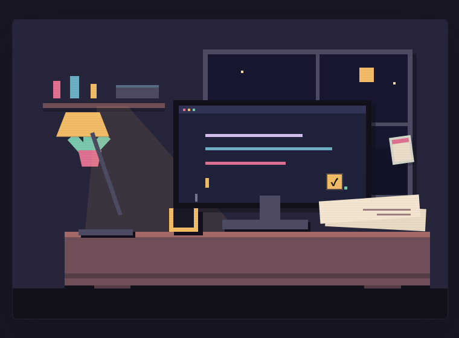
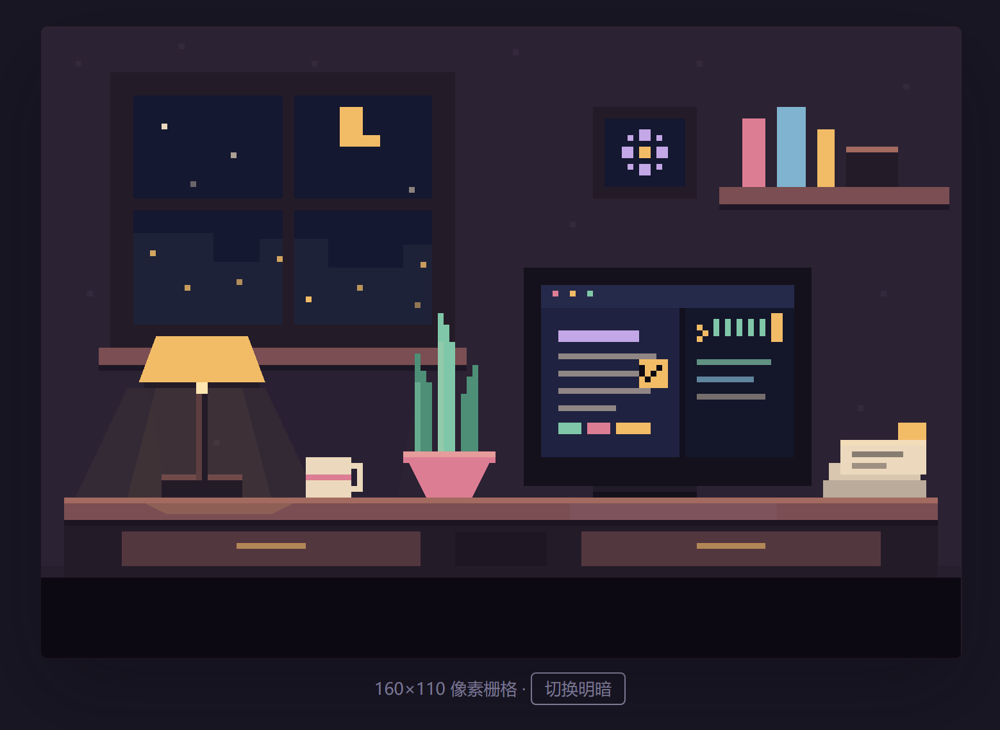
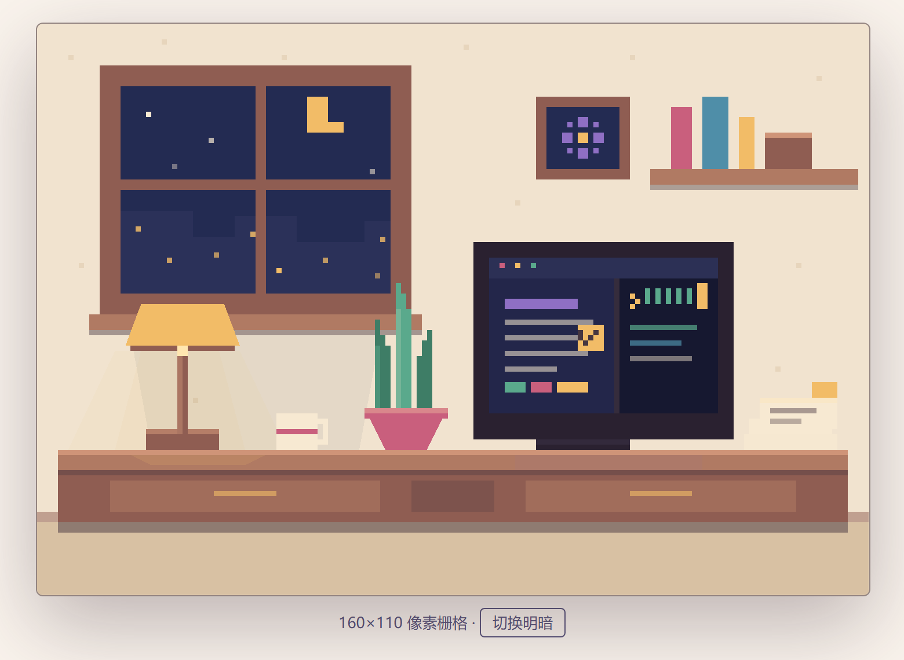

现在主页的那个动图，还是有一些明显的问题，你作为最厉害的模型，能不能调研一下，然后给我画个新的？

## 调研

### 现状截图

复刻当前 `PixelStudio` 场景并以 720px 宽度无头渲染（主题 rose-pine）：

### 为什么它会"明显感觉不对"

问题不是一两处配色，而是四个系统性的错，每个都直接对应截图里的怪相：

1. **没有像素栅格。** 组件用 div + 百分比定位 + 固定 px + 任意角度 `rotate()` 拼成，
   每个元素吸附在各自的坐标系上。灯罩（`left:10%`）和绿植（`left:12%; width:80px`）
   就是这样撞在一起的——截图里灯罩下方那块薄荷绿和玫红，其实是整株植物被灯完全遮住
   只露出叶子。旋转的叶片在"像素画"里产生反锯齿边缘，放大后像低保真几何拼贴。
2. **窗户读作墙上的空画框。** 夜空、墙体、窗内建筑三种颜色明度几乎相同，窗占 46% 宽
   却没有任何可识别内容；显示器又压住了窗的大半。整幅画最大的面积是一块单色空墙。
3. **没有叙事焦点。** 雨、星、光标、蒸汽、漂浮纸片、✓ 变色六个动画同时循环，彼此无关。
   其中"漂浮纸片"固定叠在窗框上（截图右侧白块）——它是画面里最像 bug 的元素。
4. **物件语义断裂。** 咖啡杯是金色 U 形边框，读作括号；屏幕里的 ✓ 随机会变绿；
   物品全是固定深色 hex，只有墙混了主题色，于是在浅色主题下就是一块突兀的深色卡片。

## 新方案（已绘制）

把场景从"程序员深夜"的刻板印象改成**"Iris 的一个工作瞬间"**：显示器左文档右终端，
文档逐行生长、最后盖章，终端逐字输入、光标闪烁——这是唯一的主叙述；雨、蒸汽、
星光退为环境层。物件本身就是产品的隐喻：书架上的三色书脊和桌上带标签的文档堆
对应 status/issue/report，墙上画框是像素鸢尾花。

绿植改用虎皮兰式竖叶造型（阶梯尖端、深浅两色叶片 + 花盆口沿），
不再用对称斜阶梯拼叶片——旧画法在像素栅格上会读成锯齿纹而不是植物
（2026-11-23 修订，截图已更新）。

技术上的根本改动：

* **严格 160×110 像素栅格的内联 SVG**（`viewBox` + `shape-rendering: crispEdges`），
  所有坐标、尺寸都是整数，任何容器宽度下比例恒定，不存在两套坐标系。
* 不用任何旋转画对角线，斜向全是阶梯（叶片、月牙、光锥）。
* 动效有主次：打字/盖章为焦点（10s 循环），雨 1.5s、蒸汽 3s、星光 7/9s 仅作氛围；
  去掉 hover 视差和 ✓ 随机变色。
* 明暗两套 token 直接映射到主题 `color-scheme`，任意主题下物件与墙面都成立
  （浅色主题下是暖色的白天书房，深色下是夜晚）。
* `prefers-reduced-motion` 下不再是空白画面，而是定格在"文档写满、盖完章"的完成态。

### 预览

浏览器打开 `./2026-11-23-主页绘图的一些问题.assets/pixel-studio-v2.html` 可看完整动效，
右下角可切换明暗；`#light` 锚点直接进浅色。

深色：

浅色：

## 验证

* 无头 Chrome 按 720px 实际显示宽度渲染截图，核对深/浅两套配色与像素栅格对齐。
* 静态帧（reduced-motion 降级态）确认打字字符、状态条、盖章全部可见；
  修复了 `animation-fill-mode: backwards` + delay 导致元素永久不可见的问题
  （用最小探针页隔离复现），改为"默认隐藏 + 动画覆盖"的写法。
* 动画关键帧的逐帧时序未经真实窗口逐帧检查（无头截图对 CSS 动画采样不稳定），
  以完整循环预览为准。

## 实施（2026-11-23 已移植）

视觉方向确认后已移植进应用，预览页即最终形态：

* `WelcomeView.tsx` —— `PixelStudio` 重写为 160×110 栅格的内联 SVG（雨滴、终端
  打字序列用数据数组 + `animationDelay` 内联驱动）；`WelcomeView` 其余部分未动。
* `global.css` —— 旧的 div 拼贴样式整块删除，换成 `.iris-pixel-scene` /
  `.iris-pixel-art` 与 9 组关键帧；配色走 `light-dark()`，全部主题按各自的
  `color-scheme` 自动取明/暗一套；`prefers-reduced-motion` 下定格为文档写满、
  盖章完成的静态帧。
* 旧类名（backdrop/monitor/floating-page 等）已确认无残留引用。

## 验证

* `npm run typecheck`（node/preload/web + check:async）通过。
* 按项目约定未起开发服务器截图；真实窗口动效与各主题观感留手工验收。

## 待手工验收

* [ ] 应用欢迎页动效循环（打字 → 盖章 → 清空重来）节奏自然，无跳变
* [ ] 至少一个浅色主题（如 rose-pine-dawn）+ 一个深色主题下配色成立
* [ ] 系统开启「减弱动态效果」时显示静态完成帧
