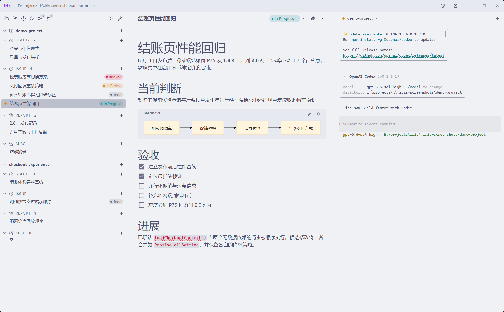
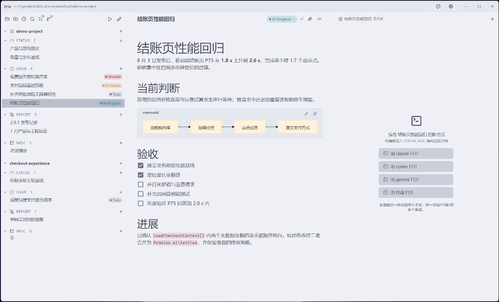
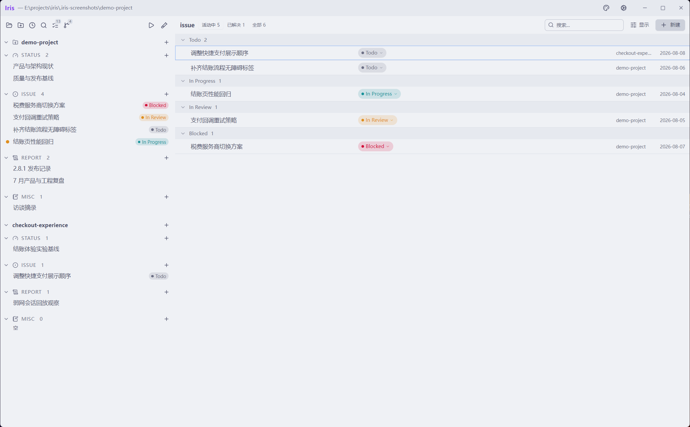

<p align="center">
  
</p>

<p align="center">
  <a href="./README.md">简体中文</a> · English
</p>

<p align="center">
  A local-first human-agent development workspace built around durable project memory.
</p>

Iris brings project documents, agents, Git state, and human attention into one desktop workspace. It does not provide a model service or replace your agent CLI. Instead, it gives the tools you already use a durable project memory and a visible place to work together.

Your project state stays in ordinary Markdown under `.iris/`. External agents run in real PTYs at the project root. Git remains the collaboration and delivery layer. There is no Iris account, cloud database, or proprietary project format.

> Current source version: `0.1.0`, the first version without a prerelease suffix. The first release supports Windows x64 only; see [GitHub Releases](https://github.com/Liyue-Cheng/iris/releases) for available downloads. The embedded Iris Agent remains experimental and disabled by default.

> This is the English product overview. Active development records and maintainer discussions are currently written primarily in Simplified Chinese. English bug reports and pull requests are welcome, but contributors may need translation support when following the live `.iris/` project record.



## Why Iris

Agentic development changes the bottleneck. Producing code is faster, but the surrounding work is still fragmented:

- Context is repeatedly copied into short-lived chats and terminals.
- Progress is hidden inside several concurrent sessions.
- An agent waiting for input looks the same as one still working.
- Decisions and results often remain in conversation history instead of the project.
- Traditional project managers describe work but do not share state with local agents.

Iris treats those as one coordination problem. Documents are long-term memory. Terminal sessions are working memory. The filesystem is the contract between humans, agents, editors, and Git.

## The Design Bet

Iris assumes that as agents make code production cheaper, the scarce work moves elsewhere: expressing intent, preserving constraints, tracking unresolved questions, evaluating evidence, and continuously refining what the project knows about itself. Running more agents is useful, but execution throughput is not the highest-level problem if nobody can reliably recover why the work exists or decide whether the result is correct.

Most agent tools make the agent or its conversation the unit of continuity. Iris makes the project the unit of continuity instead. Agents are interchangeable execution resources, and terminal sessions are disposable contexts. A session may end, its context window may fill, or one agent CLI may be replaced by another without taking the project's memory with it. Anything worth keeping must be externalized as an issue, status, report, task, code change, test, or Git history rather than remaining trapped in a transcript.

This makes Iris a project-centered human-agent development workspace. Issues describe the gap between current reality and desired reality; disposable agent sessions interpret and act on that intent; code and tests provide implementation evidence; reports preserve dated findings; and status documents restate the current system after reality changes. The loop is durable even when every agent that participated in it is gone.

```text
intent and constraints -> disposable agent execution -> code and evidence
          ^                                               |
          `----- reports and current project state <------'
```

## Built with Iris

Iris is developed entirely through its own workflow. The [`.iris/`](./.iris/) tree in this repository is the live project record, not a sample: issues preserve intent and investigations, status documents mirror the current implementation, reports retain dated conclusions, and task checkboxes keep unfinished human decisions visible.

Features and regressions are worked from focused documents in Iris, implemented through interchangeable agent CLIs running in real PTYs, verified in code and tests, and written back to the project record before Git preserves the result. This continuous dogfooding is the primary evidence for the design: project memory survives individual agents and sessions because the durable context belongs to the repository.

## The Core Workflow

1. Open a local project in Iris.
2. Initialize the Iris protocol, or use an existing `.iris/` tree.
3. Create or select an issue, status document, report, or workspace hub.
4. Launch Claude Code, Codex, Gemini, another CLI, a plain shell, or the experimental Iris Agent from that context.
5. Give the agent an instruction. Iris has already supplied the document or workspace context when the configured CLI supports it.
6. Let the agent edit code and Markdown on disk.
7. Iris watches the files and re-projects the interface from the new disk state.
8. Review the result, update the issue, and commit through Git.

Launching a session is not dispatching a background job. The agent starts interactively and waits for you. You can leave, work elsewhere, and return when the session state indicates that it may need attention.



## Three Product Layers

Iris separates a portable protocol from its desktop implementation and its agent adapters.

### The `.iris/` protocol

The protocol is a filesystem convention plus agent guidance. It can be read and edited without the Iris application.

```text
my-project/
|-- AGENTS.md
|-- .iris/
|   |-- settings.json
|   |-- external.txt
|   |-- status/
|   |   `-- architecture.md
|   |-- issue/
|   |   |-- 2026-08-08-fix-auth.md
|   |   `-- 2026-08-08-fix-auth.assets/
|   |-- report/
|   |   `-- 2026-08-08-auth-review.md
|   |-- misc/
|   `-- spike-new-parser/
|       |-- status/
|       |-- issue/
|       `-- report/
`-- src/
```

Four folder names have built-in meaning wherever they appear inside `.iris/`:

| Folder | Time orientation | Purpose |
| --- | --- | --- |
| `status/` | Now | Maintained descriptions of the current codebase |
| `issue/` | Future and active work | Problems, tasks, decisions, and their working record |
| `report/` | Dated past | Reviews, analyses, summaries, and other deliverables |
| `misc/` | Outside the workflow | Human scratch space with no freshness contract |

The nearest typed folder decides a document's type. Any directory that directly contains a typed folder is inferred as a workspace. There is no workspace manifest or database. A workspace under `report/` is not automatically archived; activity depends on each document's status. The project root's `.iris/settings.json` stores project prompts and toolbar configuration. Each workspace may have an optional `external.txt` association index.

Frontmatter keys are literal interfaces, while values remain flexible:

```markdown
---
title: Harden session replay
status: In Progress
---
```

Issue states default to `Todo`, `In Progress`, `In Review`, `Blocked`, `On Hold`, `Done`, or `Canceled`. Status, report, and misc documents use `Active` and `Backlog`. `On Hold` means inactive but unresolved; `Done` and `Canceled` mean resolved. Iris preserves exceptional values instead of rejecting the document. Transitions to inactive states through the UI first settle linked sessions; completing an issue can optionally check its remaining tasks, according to settings.

The `labels:` frontmatter field is reserved but not currently enabled. Iris
preserves valid legacy metadata, but the application and its managed agent
guidance do not create, edit, display, group, or filter by labels.

Unchecked GFM task items in active issues are projected into the Todo panel:

```markdown
- [ ] Reproduce the failure in the packaged build
- [ ] Verify the fix with Codex and Claude Code
```

Checking a task in the panel writes back to that exact line in the source document.

### The desktop application

The Electron app is the reference implementation and operational control plane for the protocol. It provides:

- Recursive `.iris/` scanning and live filesystem projection
- A document lens, a project file tree, and workspace external file associations
- Project initialization and inferred sub-workspaces
- Type-specific collection views
- WYSIWYG Markdown editing with a source-mode escape hatch
- Managed document assets
- Multiple interactive PTY sessions per document or workspace
- An experimental Iris Agent, disabled by default
- Git status, staging, unstaging, commits, and local branch switching
- Multiple project windows with isolated session and watcher state
- Machine-level themes, editor behavior, terminal behavior, and agent configuration
- Simplified Chinese and English UI, project prompt management, and configurable project toolbar commands

The protocol preserves portability. The app adds workflow efficiency, safety checks, and explicit concurrency boundaries.

### Agent execution

By default, Iris runs agent commands that are already installed and authenticated on your machine. Default entries include Claude Code, Codex, Gemini, and a plain terminal; the list and command lines are editable.

The embedded Iris Agent is disabled by default and requires your own model provider, API key, and model configuration. It supports streaming conversations, image attachments, file operations, managed terminals, subtasks, MCP tools, context compaction, and local session history and recovery. These features remain experimental and are intended for testing and feedback.

A document session receives:

```text
FOCUS_DOC=.iris/issue/2026-08-08-fix-auth.md
```

A workspace hub session receives `IRIS_WORKSPACE_PATH` and deliberately has no focused document.

Iris can generate a SessionStart context script at `~/.iris/focus-context.ps1`. After confirmation, it can connect hook configurations for Claude Code, Codex CLI, Gemini CLI, Qwen Code, and Cursor CLI; behavior depends on the installed CLI's hook support. The script injects document or workspace context; documents larger than 32 KiB receive a read instruction instead of inline contents. CLIs without hook support can still read the environment pointer and project guidance directly.

Static project rules live in entry files such as `AGENTS.md`. Dynamic focus lives in the session environment. The two have different lifetimes and are intentionally kept separate.

## The Interface

### Left: work and attention

The lens tree groups documents by workspace and type, emphasizing active documents. Inactive issues with linked sessions can remain accessible, including exited terminals that have not been closed. Session state dots show whether an anchored terminal is producing output, quiet and possibly waiting, or exited. A quiet terminal does not establish that work is complete.

Switch to the file tree to browse project files, sort by name or modification time, and filter by filename or relative path. Clicking a file opens it in the system default application; use the document lens or collection views to edit Iris documents. The tree also supports copying paths, dragging files, and managing workspace external associations.

The left pane also provides project switching, recent projects, new windows, workspace creation, search, sorting, the Todo panel, and Git source control.

### Middle: documents and collections

Single-document views separate structured frontmatter from the Markdown body. The typed header owns title, status, save state, and assets. The body uses a Crepe/Milkdown WYSIWYG editor with GFM, LaTeX, syntax-highlighted code blocks, Mermaid previews, image upload, and a CodeMirror source mode.

Each document type has a different collection view:

- Issues support activity filters, search, workspace filters, grouping, sorting, and keyboard navigation.
- Todo aggregates unchecked tasks from active issues.
- Status lists maintained descriptions of the current system, without comparing `reflects` against Git HEAD.
- Reports are arranged as a dated timeline.
- Misc stays intentionally simple.

### Right: real terminals

The right pane is xterm.js connected to a real local PTY, not a chat transcript. A document or workspace may own multiple sessions. Terminals support search, clipboard integration, file drop, document drop, resize-aware geometry, and full-state replay when remounted.

Project and workspace hubs give the terminal the full work area. A selected document uses a resizable editor-and-terminal split. Collection views use the full area for management work.



## Files Are the Contract

Iris never interprets an agent's prose output to decide whether work is complete. It observes durable state instead:

- Agent edits arrive through filesystem events.
- The renderer rescans and projects the current disk state.
- Editor writes use compare-and-swap baselines to detect external changes before replacing document content.
- View changes, Git actions, project switches, and application close pass through editor flush and conflict checks before leaving a dirty draft. This does not guarantee recovery of unsaved drafts after a crash.
- Project operations carry a canonical root and generation so late events from an old project cannot affect the new one.
- Discrete in-app mutations are serialized by resource through the FrontCPU instruction pipeline. Cross-window writes to user-owned configuration files are still being hardened.

These safeguards make plain files practical in a human-agent workflow, but Iris does not claim general transactional semantics for arbitrary simultaneous writers.

## Sessions as Working Memory

Sessions are anchored when created. One document can have several sessions, while root and nested workspaces can have unfocused hub sessions. If a document is deleted externally, Iris moves its running terminals to the workspace or root hub and shows a warning. This does not retarget the running agent's context.

The main process owns the PTY pool. A headless xterm mirror tracks the complete terminal state, including alternate-screen TUIs. When a renderer remounts a terminal, Iris serializes that state and then resumes live output without double-writing the replay boundary.

External CLI and shell PTY sessions survive renderer reloads and interface switches while the owning window remains open. PTY processes do not persist across application exit, window close, or project replacement. The experimental Iris Agent separately supports local session history and recovery; it does not restore terminated terminal processes.

## Document Assets

A document may own a sibling companion directory:

```text
2026-08-08-auth-review.md
2026-08-08-auth-review.assets/
```

Imports use the sanitized original filename, adding a numeric suffix on collisions. The asset panel distinguishes only internal files referenced from the companion directory and external file/directory associations recorded in `links.txt`.

Each workspace root may also contain an `external.txt` file with one associated external file or directory per line; blank lines and `#` comments are ignored. Relative paths resolve from the workspace directory, while absolute paths remain machine-specific. The left-pane External section can open items with their default application, reveal them in the file manager, copy their paths, or drag them into the Markdown editor and terminal. Removing a reference, document, or workspace never deletes an external target. `external.txt` is a workspace attachment index, not a fifth document type and not the per-document `links.txt` file.

Iris does not automatically download remote assets or delete orphans. Deleting a document moves the Markdown file and its companion directory to the system trash as one aggregate.

## Git Integration

The built-in Git view is deliberately small and local:

Renames, simultaneous staged and unstaged changes, unborn repositories, nested projects, linked worktrees, commit-failure recovery, and cross-window serialization have automated coverage. Installed builds still require testing on the target machines.

- Repository status and branch information
- Merge, staged, working-tree, and untracked groups
- Stage and unstage selected paths
- Commit staged changes
- Switch local branches
- Ahead and behind indicators when Git provides them

Iris currently does not provide diff editing, fetch, pull, push, remote account integration, or a merge-conflict editor. Use your existing Git tools for those operations.

## Install

### System requirements

- Windows 10 or Windows 11, x64
- Git available on `PATH` for source control features
- At least one agent CLI installed and authenticated, or use the plain terminal
- PowerShell for the Windows SessionStart hook

The first release does not support Linux or macOS.

### Release builds

Download published builds from [GitHub Releases](https://github.com/Liyue-Cheng/iris/releases). The Windows x64 packaging configuration provides two forms:

- `Iris-<version>-setup.exe`: per-user installer with Start menu and optional desktop shortcuts
- `Iris-<version>-portable.exe`: single-file portable build

Iris is not currently code-signed. Windows SmartScreen may display an unrecognized publisher warning. Verify that the file came from this repository's GitHub Releases page before running it.

The installer and portable build share machine-level settings under `~/.iris/`. Uninstalling the application does not delete those settings or any project `.iris/` data.

## Quick Start

1. Launch Iris and choose **Open Project Folder**.
2. If the project has no `.iris/`, review and confirm **Initialize Iris Protocol**.
3. Open **Settings > Agents** and configure the CLI commands you use; optionally enable the early embedded agent under **Settings > Iris Agent**.
4. Optionally install the SessionStart hook for zero-turn focus injection.
5. Create an issue or select an existing document in the lens tree.
6. Use the right-pane launcher to open an agent under that document.
7. Give the agent a concrete instruction and review its changes on disk and in Git.

Initialization creates the four typed directories and adds or refreshes an Iris-owned `<iris-software>` block in `AGENTS.md`. Project prompts are sourced from `prompts.project` in `.iris/settings.json` and synchronized through settings into the `<iris-project>` blocks of managed entry files. Initialization can enroll existing vendor entry files; files added later require explicit enrollment. External edits to entry files appear as drift or conflicts instead of silently replacing the project configuration.

## What Iris Does Not Do

These are current product boundaries, not hidden roadmap promises:

- No Iris-hosted model, model account, or model subscription; users still manage external CLIs and optional Iris Agent provider configuration
- No account, cloud database, hosted sync, permission system, or telemetry
- No unattended agent scheduling service independent of the desktop app; the embedded agent can run subtasks within a session
- No parsing of agent terminal output as business state
- No built-in code editor
- No persistent PTY sessions after the owning window closes
- No custom document types in the current protocol
- No complete Git client
- No Linux or macOS support in the first release

Iris coordinates local tools instead of replacing them.

## Development

### Prerequisites

- Node.js 22 LTS (22.19+) or 24 and newer (CI uses Node.js 24)
- npm
- An environment capable of running Electron and `node-pty`; build Windows release artifacts on Windows

`front-cpu` is installed from the npm registry, so a clean checkout does not require a sibling repository.

### Commands

```powershell
npm ci
npm run dev
```

Quality checks:

```powershell
npm test
npm run typecheck
npm run metadata:check
npm run licenses:check
```

Production build and checks that require its output:

```powershell
npm run build
npm run agent:worker-check
npm run smoke
```

Create x64 installer and portable artifacts on Windows:

```powershell
npm run dist
```

Artifacts are written to:

```text
dist/release/<version>/
```

`npm run dist` refuses to package a stale third-party notice file. After changing dependencies, run `npm run licenses:generate` and review the generated diff.

The development build uses separate app data and a separate Electron single-instance profile, so it can run alongside an installed build. Development and release builds share context hook scripts under `~/.iris/` and external CLI configuration.

## Architecture

```text
src/main/       Electron lifecycle, project scanning, file watchers, PTYs,
                assets, Git, persistence, prompts, Agent worker, tool runtime, IPC
src/preload/    Narrow context-isolated renderer bridge
src/renderer/   React interface, projection stores, editors, terminal view,
                FrontCPU instruction definitions and interrupts
src/shared/     Cross-process models, IPC channel names, Markdown utilities,
                status definitions, terminal keybindings
```

The main process is authoritative for project scope, disk access, PTY lifetime, and Git operations. The renderer keeps read-side projections and sends mutations through the instruction pipeline. Continuous terminal I/O bypasses that pipeline to avoid per-keystroke scheduling overhead.

Key technologies include Electron, TypeScript, React 18, Tailwind CSS, Radix UI, Milkdown/Crepe, CodeMirror 6, node-pty, xterm.js, chokidar, gray-matter, remark, Mermaid, Vitest, and FrontCPU.

## Current Status

`0.1.0` is the source version selected for the first release without a prerelease suffix, continuing the beta series' workflow of `.iris/` documents, external agent CLIs, terminals, and local Git. Protocols and interactions may continue to evolve during `0.x`; this is not a frozen 1.0 interface.

The embedded Iris Agent remains experimental and disabled by default. A source version number does not establish release readiness; see the [release review](./.iris/issue/2026-09-28-发布前检查.md) for findings and outstanding verification.

Bug reports and focused design discussions are welcome through [GitHub Issues](https://github.com/Liyue-Cheng/iris/issues).

## Data and Privacy

- Project artifacts remain in the project repository as ordinary files.
- Machine settings are stored locally under `~/.iris/` (`~/.iris-dev/` for development builds).
- External agent authentication and billing remain with each CLI. API keys for the optional Iris Agent are stored as plaintext in local provider configuration JSON. The embedded agent sends model requests and relevant context to the configured provider.
- Iris does not send telemetry.
- External links open in the system browser only for allowed web and mail protocols.
- Local document and asset operations validate paths against the active project boundary. Do not rely on symlinks or junctions to bypass that boundary; use explicit association indexes for external files.

Review agent-generated changes with the same care you would use in a standalone terminal. Iris improves context and visibility; it does not sandbox the commands your local agents can run.

## License

Iris is released under the [MIT License](LICENSE). Windows distributions also include the generated [third-party software notices](THIRD_PARTY_NOTICES.txt), Electron's license, and Chromium's notices.
